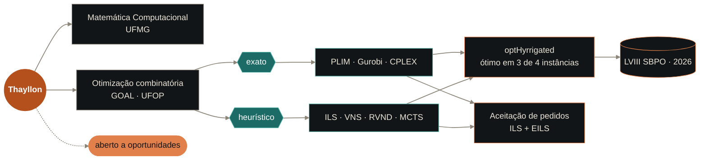

  

  
  
  
  

 

Estudante de **Matemática Computacional na UFMG**, com pesquisa em **otimização combinatória** iniciada no Laboratório GOAL (DECOM/UFOP).

Transformo problemas de decisão em modelos matemáticos e os resolvo com o método adequado: **programação inteira mista** quando o exato é viável; **heurísticas e metaheurísticas** quando a escala exige — chegando ao ótimo ou a menos de 0,1% dele.

## 🔥 Em destaque

  

**optHyrrigated** · C++ — irrigação por pivô central. Construtiva Lookahead, quatro vizinhanças do domínio combinadas via RVND dentro de um ILS, e um vetor de margem hídrica que verifica a viabilidade de cada movimento em O(1).

**Alocação de tarefas com aceitação de pedidos** — ILS com busca local substitute/drop, sequenciamento via RVND e integração com o modelo exato (EILS) em ambiente multiperíodo.

## 📄 Publicações

| | Trabalho | Evento | Ano |
|:-:|:--|:--|:-:|
| 📄 | **Aplicação do ILS-RVND para o Problema de Irrigação utilizando Pivô Central** T. R. B. de Almeida, P. L. A. Munhoz · ótimo em 3 de 4 instâncias, gap de 0,08% na maior, em menos de 3 min | LVIII SBPO | 2026 |
| 📝 | **ILS e EILS para o problema de alocação de tarefas com aceitação de pedidos em ambiente multiperíodo** T. R. B. de Almeida et al. | em preparação | 2026 |

## 🧰 Ferramentas

  
  
  
  
  
  
  
  
  
  

## 📈 Atividade

  <picture>
    <source media="(prefers-color-scheme: dark)" srcset="https://streak-stats.demolab.com?user=oBraganca&hide_border=true&background=121518&ring=55b5ab&fire=e2804b&currStreakNum=ebe5d9&currStreakLabel=e2804b&sideNums=ebe5d9&sideLabels=8c867a&dates=8c867a&stroke=2a3036">
    
  </picture>

<i>Ad optimum, per vicinitates.</i>

