<p align="center">
  
</p>

<p align="center">
  <a href="https://obraganca.github.io/curriculum/">Currículo</a> ·
  <a href="https://www.linkedin.com/in/thayllonbraganca/">LinkedIn</a> ·
  <a href="mailto:thayllonbraganca@gmail.com">E-mail</a>
</p>

Estudante de **Matemática Computacional na UFMG**, com pesquisa em **otimização combinatória** iniciada no Laboratório GOAL (DECOM/UFOP). Transformo problemas de decisão em modelos matemáticos e os resolvo com o método adequado: **programação inteira mista** quando o exato é viável; **heurísticas e metaheurísticas** quando a escala exige.

```cpp
struct Thayllon {
    std::string formacao   = "Matemática Computacional @ UFMG";
    std::string pesquisa   = "Otimização combinatória · GOAL/UFOP";
    std::vector<std::string> exato      = {"PLIM", "Gurobi", "CPLEX"};
    std::vector<std::string> heuristico = {"ILS", "VNS", "RVND", "MCTS"};
    std::string objetivo   = "o ótimo — ou a menos de 0,1% dele — em tempo viável";
};
```

### Em destaque

**optHyrrigated** · C++ — irrigação por pivô central
ILS+RVND com construção Lookahead, quatro vizinhanças do domínio e verificação de viabilidade em O(1) pelo vetor de margem hídrica.

| Instância | Dias | Gap para o ótimo | Tempo médio |
|:--|--:|--:|--:|
| Soja | 120 | **0,00%** | 7,9 s |
| Milho | 140 | **0,00%** | 7,4 s |
| Algodão | 180 | **0,00%** | 13,6 s |
| Cana-de-açúcar | 540 | 0,08% | 158,5 s |

📄 *Aplicação do ILS-RVND para o Problema de Irrigação utilizando Pivô Central* — **LVIII SBPO**, 2026.

**Alocação de tarefas com aceitação de pedidos** — ILS com busca local substitute/drop, sequenciamento via RVND e integração com o modelo exato (EILS) em ambiente multiperíodo.

### Ferramentas


### Atividade

<p>
  
  
</p>

<sub><i>Ad optimum, per vicinitates.</i></sub>
